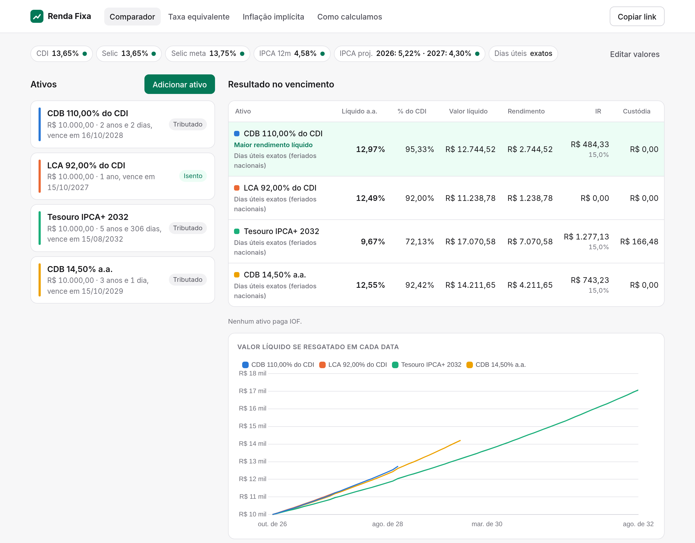
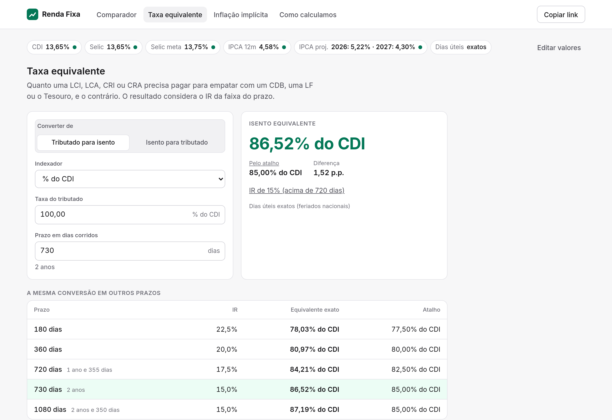
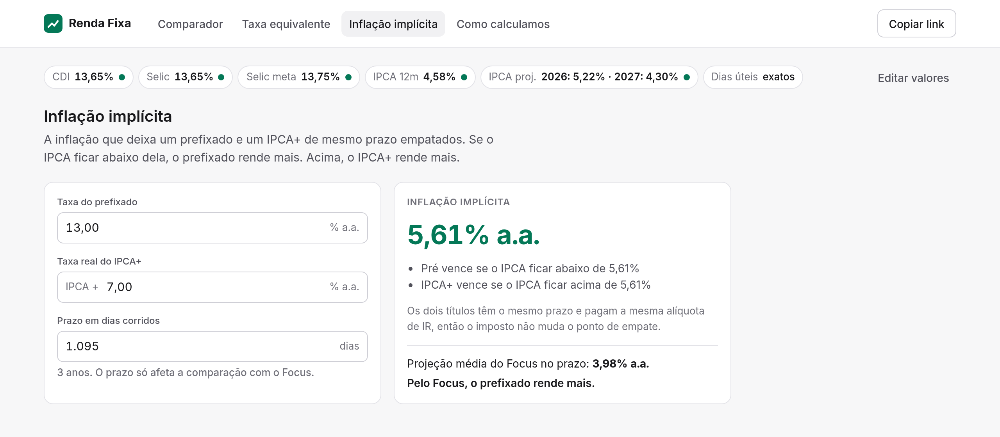
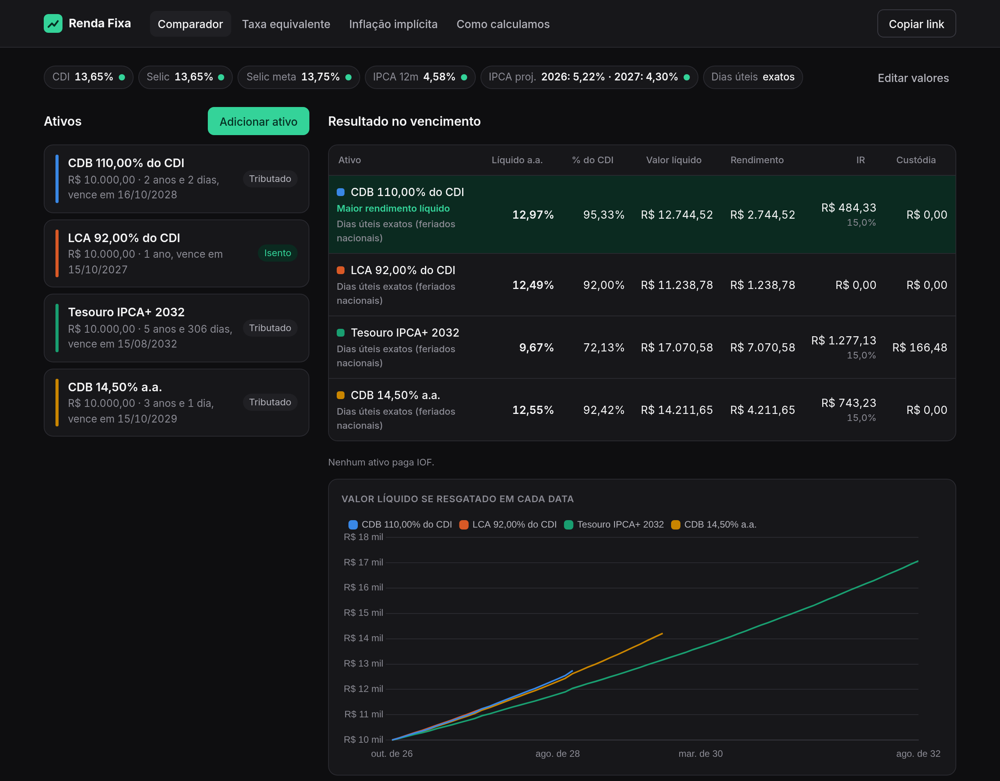
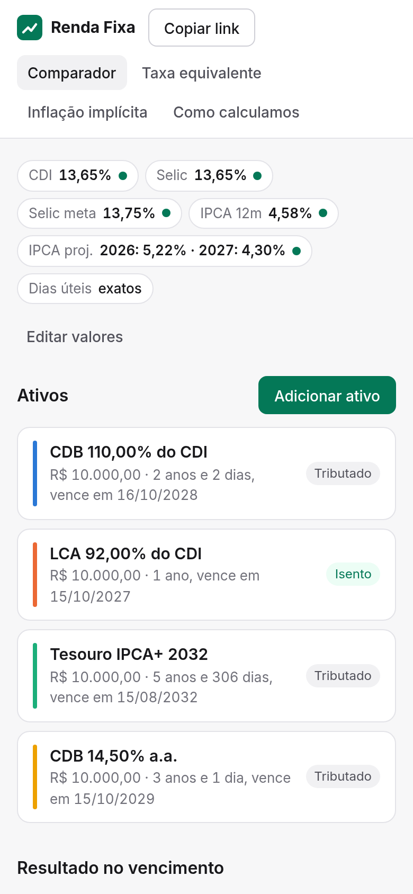

# Calculadora de Renda Fixa

Compare CDB, LCI, LCA, LIG, LF, CRI, CRA, debêntures e Tesouro Direto pelo rendimento líquido, com IR, IOF e taxa de custódia.

**Acesse:** https://moesio-f.github.io/comparador-renda-fixa/



## Por que mais uma calculadora

As calculadoras conhecidas pedem e-mail, exigem login ou registram o que você digita para análise. Esta roda inteira no seu navegador:

- Sem cadastro, sem cookies e sem ferramentas de analytics.
- Seus ativos ficam salvos só no `localStorage` do seu navegador.
- O link de compartilhamento guarda a comparação depois do `#` da URL. Essa parte nunca é enviada ao servidor.
- O app não tem servidor próprio. O GitHub Pages entrega os arquivos estáticos, e o navegador busca os dados direto da fonte.

Os únicos acessos externos são:

| Destino | Para quê |
|---|---|
| `api.bcb.gov.br` e `olinda.bcb.gov.br` | CDI, Selic, IPCA e projeções do Focus (Banco Central) |
| `brasilapi.com.br` | Feriados nacionais, para contar dias úteis |
| `fonts.googleapis.com` | Fonte Inter |

Se alguma fonte falhar, você pode digitar os valores à mão.

## O que dá para fazer

**Comparador.** Adicione quantos ativos quiser, cada um com taxa, valor e vencimento próprios. A tabela mostra o valor líquido, a taxa líquida ao ano e o equivalente em % do CDI. O gráfico mostra quanto você receberia se resgatasse em cada data.

**Taxa equivalente.** Quanto uma LCI ou LCA precisa pagar para empatar com um CDB, e o contrário. O resultado exato aplica o IR uma vez sobre o ganho acumulado. O atalho `taxa × (1 − IR)`, usado na maioria dos simuladores, aparece ao lado para comparação.



**Inflação implícita.** A inflação que deixa um prefixado e um IPCA+ empatados, comparada com a projeção do Focus para o prazo.



**Como calculamos.** Cada fórmula, premissa e fonte de dados está documentada dentro do app, com exemplos que usam o CDI do dia.

| Tema escuro | Celular |
|---|---|
|  |  |

## Premissas

- CDI e Selic ficam constantes no valor atual durante todo o prazo.
- IPCA+ usa a mediana do Focus de cada ano. Anos depois da última projeção repetem a última.
- Os dias úteis descontam os feriados nacionais. Se a lista de feriados não carregar, o app usa `dias corridos × 252 / 365` e avisa no resultado.
- As regras de IR, IOF e custódia valem para pessoa física e ficam em [`src/lib/engine/tax-rules.ts`](src/lib/engine/tax-rules.ts).

Simulação para estudo, sem recomendação de investimento.

## Rodando localmente

Requer Node 24.

```sh
npm ci
npm run dev     # servidor de desenvolvimento
npm test        # testes do motor de cálculo
npm run check   # checagem de tipos
npm run build   # gera dist/
```

Cada push na `main` roda os testes e publica no GitHub Pages pelo workflow em `.github/workflows/deploy.yml`.
